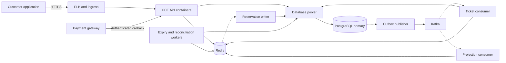
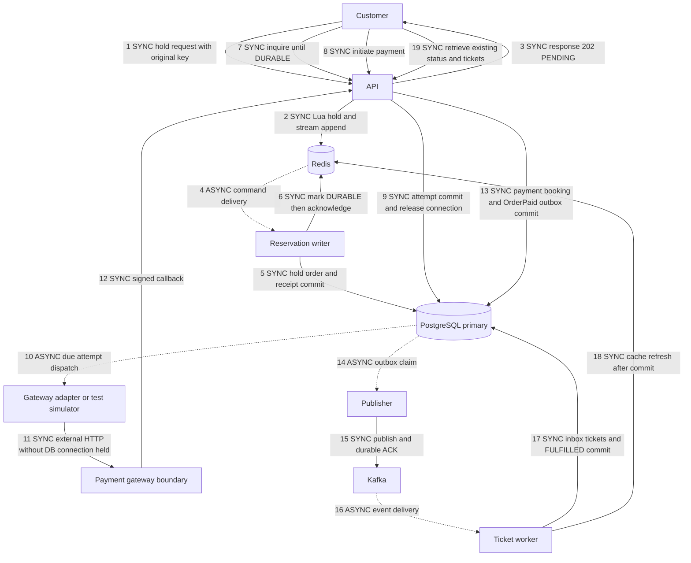

# Concert ticketing implementation guide for delivery teams

A practical guide for developers, QA engineers, cloud engineers and cloud solution architects implementing atomic reservations, recoverable payments and asynchronous ticket issuance in an existing platform.

**Reference snapshot:** 15 October 2026. Reviewed repository revision `b71fa1324f12b8645442773ea8a7f44fee7994ba`, branch `codex/customer-recovery-2026-10-10`. The tested reference, proposed customer integration and production requirements are distinguished below. A real gateway adapter and customer implementation remain separate delivery work.

Start with one isolated concert and one booking authority. Preserve the customer's language, identities and business rules. Introduce reliable recovery and durable messaging before enabling more aggressive intake. Redis speeds selected operations; PostgreSQL remains the durable financial and booking authority; Kafka carries work that can complete after the customer request returns.

## 1 Responsibilities and first decisions

| Role | Start here | Deliverables | Handoff evidence |
| --- | --- | --- | --- |
| Developer | Sections 3 to 6 and 9 | API and state contracts, schema, idempotency, gateway adapter, outbox, workers, authorized cache and frontend recovery | Reviewed code, migrations, contract tests and replay results |
| QA engineer | Sections 4, 8 and 10 | Test data, failure injection, complete journey accounting, financial reconciliation and qualification | Reproducible cases, independent audits and retained failures |
| Cloud engineer | Sections 6 to 9 | Network, TLS, secrets, images, CCE workloads, broker/database connectivity, monitoring and rollback | Effective deployed configuration, connection budgets, readiness and restore proof |
| Cloud solution architect | Sections 2, 3, 7 and 10 | Service boundaries, system of record, HA/DR, sizing, cost limits and ADRs | Dependency map, capacity assumptions, accepted trade-offs and operating model |

The developer lead owns application contract consistency. QA owns qualification. The cloud engineer executes deployment and restoration. The architect reviews cross-service decisions. Business owners approve customer promises, spending limits and major trade-offs; routine engineering proceeds within those boundaries.

**First joint session:** agree the pilot event, language/framework, schema, gateway, existing seat writer, broker, pooler, customer error/latency/freshness targets, outage recovery objectives, test spending and deployment permissions. Assign a named owner to each unresolved production requirement in section 10.

## 2 Evidence and capacity expectations

| Evidence | Result | Permitted conclusion |
| --- | --- | --- |
| [Clean 140 offered journeys/s comparison](../capacity/cce/fixed-budget-140-throughput-result-2026-10-15.json) | Five minutes; 42,000 scheduled, dispatched and eventually fulfilled; zero drops, initial customer errors or final failures | A clean short test on the recorded configuration |
| Issuance inside that window | 41,827 unique paid-and-issued tickets; conservative count 41,547, or **138.49 tickets/s**, with the recorded two-second inner-window guard | Successful in-window throughput differs from offered rate and eventual completion |
| Same test quality | Worst-shard total journey p95 2.566 seconds; financial checks, zero double-booking, drain and restoration passed | These outcomes passed together in this sample; p95 is not a pooled percentile |
| [160 offered journeys/s attempt](../capacity/cce/fixed-budget-160-throughput-result-2026-10-15.json) | 48,000 scheduled, 47,875 dispatched/fulfilled, 125 undispatched; 16 initial payment errors recovered; zero final failures | Arrival-quality gates failed; this does not establish application capacity at 160/s |
| [Primary-only bootstrap safety](../capacity/cce/secondary-ecs-retirement-live-2026-10-15.json) | Hold contention, replay, one simulated paid ticket, post-expiry audit, drain and restoration passed | The explicit CCE bootstrap path no longer needs the secondary ECS; this was not a throughput test |

The short-test gateway was simulated. The latest configuration has not been qualified at 138.49/s for a full hour or through a real concert-opening surge. Earlier hourly evidence used different configurations and gates; separate results cannot be combined into a new qualification. A five-minute rate is a pilot starting point, not a customer SLA.

**Business target:** 300,000 unique paid-and-issued tickets inside one hour requires 83.3333 tickets/s on average. With one ticket per journey, 84 offered journeys/s schedules 302,400 journeys/hour. Multiple seats per order, abandonment, declines and browsing change the relationship between journeys, tickets and HTTP requests.

## 3 Architecture and boundaries



Solid arrows represent operations that wait for a result. Dashed arrows represent background work or delivery independent of the original request. Background workers still wait for their own database commits and broker acknowledgements.

| Component | Responsibility | Boundary |
| --- | --- | --- |
| API | Authentication, validation, bounded admission, short transactions and operation inquiry | Do not wait on a bank while holding database slots |
| Redis | Advisory availability, authorized fresh status snapshots, optional provisional intake and streams | A provisional acknowledgement is not durable PostgreSQL ownership or a payment record |
| PostgreSQL primary | Durable holds, orders, payments, bookings, tickets, outbox and inbox | Transactions and unique constraints enforce the final invariants |
| Kafka | Retained event delivery to independent consumers | It does not make an external database or bank operation exactly once |
| Pooler | Controlled shared backend connection boundary | Increasing every application pool does not increase database capacity |
| Workers | Persistence, publication, issuance, projection, expiry and reconciliation | Scale roles independently within downstream limits |
| ELB and ingress | Routing, TLS termination where selected, health checks and request visibility | Routing improvements do not resolve database slot saturation |

The reference places PgBouncer and Kafka on the primary ECS, APIs and workers on CCE during paid stages, generators on a separate ECS, and state in managed RDS and Redis. The secondary ECS is unnecessary for the qualified primary-only bootstrap; deletion has not been executed by automation. This experimental placement is not a complete production HA design.

**Adapting the customer's existing stack:** retain CCE, PGpool, the application language and RDS where suitable. Verify JetStream durable delivery before substituting existing NATS for Kafka; Core NATS alone does not meet the recovery contract. PGpool needs its own routing and capacity validation. Confirm which of the reported five RDS replicas are readable versus HA standbys; replicas do not multiply write capacity. The NATS adapter and customer port are proposed work. See [the transfer specification](pattern-transfer/README.md).

## 4 Numbered journey and transaction boundaries

This is the measured Redis-first model. Customer adoption can start with PostgreSQL-first holds, which return a durable result after database commit instead of provisional acceptance.



Steps 10 to 12 show the gateway integration boundary. The reference simulator claims a due attempt and sends a signed callback to the API; it does not call a bank. A production adapter must implement actual initiation, inquiry, callback and settlement contracts.

The cited profile uses synchronous financial callback processing: commit before acknowledging. **Asynchronous confirmation is a separate option**, disabled in this profile. If adopted, acknowledge only after a durable receipt commits, then apply financial effects in a worker. A memory-only queue is insufficient.

| State | Customer meaning | Next action |
| --- | --- | --- |
| Reservation command PENDING | Provisional intake accepted, not yet durable | Inquire about the same command; payment remains blocked |
| Command DURABLE and hold ACTIVE | Database-backed reservation until original expiry | Initiate using a stable payment operation key |
| Payment outcome unknown | A request may have succeeded | Show processing and inquire about the original operation |
| Order PAID | Financial and booking effects committed | Await issuance; do not charge again |
| Order FULFILLED | Ticket records committed | Retrieve the same ticket identities |
| Expired reservation or late success | Original seat entitlement may no longer exist | Preserve newer ownership; resolve a durable refund/review obligation |

Customer waiting and gateway network delay do not require a database connection to remain checked out. Initiation, callback, uncached inquiry and issuance still need short, bounded database transactions.

## 5 Developer implementation contracts

Implement these five contracts in the customer's language. The [detailed contracts and pseudocode](pattern-transfer/contracts.md) define locking order, callback validation, late payments, message envelopes and cache behavior.

1. **Atomic holds and expiry.** Reserve every selected seat or none. Lock in canonical order and enforce booked-seat uniqueness in PostgreSQL. Replay preserves actor, payload, identity and original expiry. An old owner cannot release a newer owner's seat.
2. **Payment idempotency and recovery.** Persist stable operation/provider identities. Scope keys by authenticated customer and operation. After a timeout, inquire on the primary before replaying the identical request/key. Do not generate a new key to escape uncertainty.
3. **Financial record and outbox together.** Commit payment outcome, booking effects and the business event in one transaction. Broker failure leaves durable pending work. Avoid a financial commit followed by an unprotected publish.
4. **Duplicate-safe issuance.** Commit the consumer inbox receipt and tickets together, with unique ticket-to-booking constraints. Acknowledge only committed work. A restart after commit before ACK must not repeat business effects.
5. **Authorized cached reads and controlled connections.** Authenticate every read, scope snapshots by customer/order, publish committed state, preserve the original freshness deadline and reject older snapshots. Coalesce misses with bounded database fallback.

### Data model to map

| Group | Reference tables or concepts | Required property |
| --- | --- | --- |
| Sale and ownership | `events`, `event_seats`, `holds`, `orders`, `order_items` | Atomic selection, original expiry and compatible lock order |
| Replay | `idempotency_records`, reservation command receipts | Unique scoped identity, normalized request hash and stable response |
| Money and booking | `payment_attempts`, `payment_callbacks`, `bookings`, `refund_requests` | Stable provider identity, callback deduplication, unique booked seat and durable obligations |
| Delivery and issuance | `outbox_events`, `consumer_inbox`, `tickets`, `dead_letters` | Transactional receipt, stable event ID and one ticket per booking |
| Projection and repair | Refresh requests, reconciliation schedules, optional confirmation receipts | Bounded backlog, recoverable leases and progress across events |

Redis contains provisional ownership, command state, streams and read projections. Redis-first keys use the show's hash tag, for example `reservation-stream:{showId}` and `reservation-command:{showId}:commandId`, so a script's keys can share a Redis Cluster slot. Validate types and arguments before mutation: atomic Lua execution does not roll back earlier writes after a script error. See [the Redis implementation](../../src/ticketing/infrastructure/redis_reservations.py) and [official scripting semantics](https://redis.io/docs/latest/develop/programmability/eval-intro/).

Map existing customer IDs explicitly. Add tenancy to replay and cache scopes if needed. Money uses integer minor units and an explicit currency. Define deterministic request normalization across languages. Add migrations without editing already-applied files. Map real settlement, refunds and multiple-payment-attempt business rules before adopting simulator-specific tables.

### Recovery behavior

| Situation | Required action |
| --- | --- |
| Eligible temporary 429 or 503 | Bounded retry with jitter, identical key/payload and original deadline |
| Ambiguous payment timeout | Primary inquiry about the original operation before replay |
| Inquiry unavailable | Processing state and later retrieval; no blind new charge |
| Same key with changed request | Conflict without mutation |
| Authorization, expiry, seat conflict or deterministic decline | Follow the business outcome; no transient-error retry |
| Late successful charge after seat reassignment | Preserve payment evidence and new owner; create refund/review work |

The reference client permits at most three attempts including the first, with 100 ms base jitter and a 1000 ms cap inside the original journey deadline. Honor `Retry-After` without shortening it. These are reference settings, not permission to retry every error. Production frontend/SDK recovery must be implemented separately; the load generator is not a customer application.

A real gateway needs stable idempotency, authoritative inquiry or an explicitly accepted reconciliation process. Kafka and database deduplication alone cannot prevent duplicate external charging.

## 6 Source map and local onboarding

Paths below are relative to the repository root. Review the release commit and tested image receipt together; today's source is not proof of an older image's contents.

| Area | Start with |
| --- | --- |
| Entry and defaults | [API](../../src/ticketing/api.py), [settings](../../src/ticketing/config.py), [Dockerfile](../../Dockerfile) |
| Holds and payments | [transactions](../../src/ticketing/infrastructure/reservations.py), [Redis intake](../../src/ticketing/infrastructure/redis_reservations.py) |
| Connections and diagnostics | [PostgreSQL adapter](../../src/ticketing/infrastructure/postgres.py), [slot diagnostics](../../src/ticketing/infrastructure/slot_diagnostics.py) |
| Publication and issuance | [workers](../../src/ticketing/workers.py) |
| Authorized status | [cache](../../src/ticketing/infrastructure/order_status_cache.py), [projector](../../src/ticketing/infrastructure/order_status_projector.py) |
| Optional confirmation | [implementation](../../src/ticketing/infrastructure/payment_confirmation.py), [migration](../../migrations/009_payment_confirmation_receipts.sql) |
| Schema and indexes | [migrations](../../migrations), [initial schema](../../migrations/001_initial.sql), [order-event index](../../migrations/010_orders_event_index.sql) |
| Local stack and CI | [Compose](../../compose.yaml), [RDS overlay](../../compose.rds.yaml), [CI workflow](../../.github/workflows/ci.yml) |
| CCE experiment tooling | [runner](../../scripts/run_cce_paid_comparison.py), [API adapter](../../scripts/cce_api_adapter.py), [worker manifests](../../scripts/cce_native_workers.py) |
| Release identity | [image receipt](../capacity/cce/fulfillment-transaction-batching-local-2026-10-14.json), [reproduction checker](../../scripts/check_cce_reproducibility.py) |
| Recovery and acceptance | [recovery client](../../scripts/customer_recovery_client.py), [outcome gates](../../scripts/cce_customer_outcome_slo.py), [acceptance matrix](pattern-transfer/acceptance-checklist.md) |
| Decisions | [ADR index](../adr/README.md), [customer transfer ADR](../adr/0325-transfer-ticketing-patterns-to-customer-stack.md) |

Use Docker Desktop with Linux containers or Docker Engine and Compose on an isolated development machine. Do not point the development stack at live customer RDS or Redis.

```sh
# Development only, from a reviewed checkout
docker compose up -d --build --wait
docker compose run --rm seed
docker compose run --rm --build tests pytest -q tests/integration tests/end_to_end
```

The [README](../../README.md) has token creation and example requests. Its simulated payment initiation route is development-only. Unit checks use `python -m pytest -q tests/unit` in a Python 3.12+ environment installed from locked dependencies. These are onboarding instructions; preparing this guide did not rerun the application test suite.

Cloud runners require private configuration, fixture ownership, credentials and current bounded authorization. They are experiment tools, not production installers. Public reports alone cannot replay an old run. Never bypass stale-image, fixture or ownership guards.

## 7 Cloud deployment and architecture work

### One image with separate service containers

Use one reviewed application image with independently configured services. The API runs the web server; workers use `python -m ticketing.workers <role>`. Roles include `reservation-writer`, `publisher`, `consumer`, `projection-consumer`, `maintenance`, `reconciler`, `simulator` and optional `confirmation`. Separate `refresh` and `expiry` roles also exist. Select one reviewed maintenance arrangement to avoid unintended overlap.

The simulator is a test dependency. Production needs a real gateway adapter or service boundary; simulator controls must not be exposed to customers.

| Item | Recorded short-test configuration | Interpretation |
| --- | --- | --- |
| API | Four CCE pods, 1 vCPU and 2 GiB each | Tested allocation, not a customer sizing recommendation |
| Background work | Fifteen pods, 250m CPU and 512 MiB each | Six ticket consumers, one projection consumer, four reservation writers, one publisher, one maintenance, one reconciler and one simulator |
| Database boundary | 24 physical backends and shared admission 20 | Four APIs each use two general and two payment slots; these are not 24 extra backends per pod |
| RDS | User-declared 8 vCPU, 16 GiB, Cloud SSD | Instance class was not independently retrieved for the comparison |
| Generator | Separate ECS; two processes, 250 concurrent journeys each | Process CPU and concurrency can invalidate offered traffic before the application limit |
| Dependencies | Managed RDS and Redis; Kafka and PgBouncer on primary ECS | Broker and pooler production HA need separate design and validation |

Calculate connections across every replica, process, worker, pooler instance, database/user pool, observer, rolling-update overlap and administrative reserve. Validate the customer's PGpool separately; copying the reference's 24-backend value is not a sizing exercise.

### Capacity planning for the customer

Build a demand model from expected arrivals, requests per journey, seats per order, payment delay and abandonment. Use measured customer behavior instead of converting concurrent visitors directly into tickets/s. For example, 100,000 arrivals in 10 seconds is 10,000 arrival journeys/s; it does not imply that every journey reaches payment immediately.

For a stable measured interval, average in-flight journeys are approximately arrival journeys/s multiplied by average end-to-end journey seconds. Average busy database connections are approximately the sum, across operations, of operation arrivals/s multiplied by average connection-held seconds. Use measured averages for these estimates, then test bursts and tail latency separately. Neither calculation is a safe maximum or a substitute for an overload test.

Measure each stage's service rate and queue age: reservation persistence, callback application, outbox publication, ticket issuance and projection. The sustainable path is limited by its slowest necessary stage. Choose pod counts with tested headroom and partition/connection limits. Record Redis memory and command latency, broker retention/partition lag, RDS CPU/lock/commit behavior and pooler occupancy. Replicas help only reads whose consistency requirements allow replication lag; operation inquiry and authoritative ownership stay on the primary.

### Defaults and profile flags

| Setting | Source default | Adoption guidance |
| --- | --- | --- |
| `RESERVATION_MODE` | `postgres` | Measured CCE profile uses `redis-first`; qualify provisional durability separately |
| `PAYMENT_CONFIRMATION_ASYNC` | `0` | Cited short profile commits callback financial effects synchronously; async receipt mode needs separate qualification |
| `PAYMENT_WRITE_PIPELINE` | `0` | Retain the selected profile value; one shared image does not imply pipelining |
| `FULFILLMENT_TRANSACTION_BATCH_SIZE` | `1` | Measured fulfillment grouping uses 4; customer port starts at 1 |
| `ORDER_STATUS_CACHE_MS` | `0` | Cache disabled by default; explicitly agree freshness and fallback before activation |
| `ORDER_STATUS_COMMITTED_SNAPSHOT` | `0` | Measured lineage enables committed publication on selected consumers; preserve per-role settings |
| `HOLD_SECONDS` | `120` | Original business expiry, not a retry budget |

This table does not replace resolved configuration and dependency checks in settings. API and worker flags can differ. Do not enable every optimization simultaneously and call it the tested profile.

### Deployment sequence

1. Create isolated networks, namespace and service identities. Allow ingress to APIs, APIs/workers to Redis and pooler, pooler to RDS, and workers to the broker. Validate Kafka advertised addresses as well as TCP reachability. Keep database and broker access private.
2. Configure HTTPS, callback authentication and database hostname/CA verification. Select supported TLS/authentication for Redis and Kafka. Keep secrets out of Git and images; assign least privilege and rotation ownership.
3. Apply additive migrations through one controlled migration job. Verify constraints/indexes and old/new application compatibility. Plan application rollback without deleting financial data.
4. Publish to SWR and deploy by immutable registry manifest digest. Retain source, dependency and configuration hashes. Use a supported renewable pull-secret strategy; a 24-hour registry login is not a permanent deployment credential plan.
5. Deploy API and worker roles with explicit resources, readiness, startup behavior and graceful shutdown. Production requires reviewed Kubernetes controllers and restart policies. The benchmark's owner-scoped Pods with `restartPolicy: Never` and execution deadlines are temporary experiment resources, not production Deployments.
6. Connect service and ingress to the intended ELB. Verify callback reachability, readiness, routes, TLS termination and timeout alignment. Inspect existing load balancers before creating another.
7. Run health checks and isolated correctness/replay journeys. Prove drain and restoration. Then qualify capacity against that exact release identity.

Production design must cover pooler failure, Redis persistence/failover, broker replication/retention, RDS recovery, backups and restore drills. AOF `everysec` and `noeviction` do not make every provisional Redis acknowledgement lossless. Agree recovery point and recovery time objectives before choosing the HA topology.

## 8 QA acceptance and capacity qualification

Use [the detailed customer acceptance matrix](pattern-transfer/acceptance-checklist.md). Every customer-port scenario begins **NOT RUN**. Reference Python evidence does not turn a translated implementation's test green.

| Layer | Required scenarios | Evidence |
| --- | --- | --- |
| Unit and contract | Normalization, changed-key conflicts, expiry, state transitions, authorization, cache freshness and retry classification | Deterministic accepted and rejected cases |
| Database and Redis | Hot-seat contention, all-or-none selections, writer crash before/after commit, stale release and primary inquiry | Independent ownership/relationship audits and unchanged expiry |
| Payment and messaging | Lost responses, duplicate/reordered callbacks, broker outage, publisher crash after ACK, consumer crash after commit, late success and inquiry failure | One business effect, stable identities and durable unresolved obligations |
| Deployment and recovery | API/worker restarts, warming pods, approved Redis/pooler/broker/RDS disruption | Bounded recovery, visible backlog and restoration proof |
| Capacity | Fixed baseline and one-factor candidate with identical workload, resources and connection budget | Complete dispatch, latency, ticket, financial and drain reports |
| Concert opening | Simultaneous arrivals, hot event/seats, heavy availability reads and callbacks | Qualification for the actual shape, separate from distributed-show traffic |

In a 100-way same-seat test, one accepted hold and 99 explicit seat-unavailable conflicts are expected business outcomes. Unexpected transport failures or 503s are not silently reclassified as normal contention.

### Accounting and gates

```text
scheduled = dispatched + undispatched
completed dispatched journeys = successful journeys + final failed journeys
final failure percent = 100 * final failed journeys / dispatched journeys
verified ticket rate = unique valid paid-and-issued tickets inside window / window seconds
```

Reconcile tickets through joined payment, order, booking and ticket identities, not independent row counts. Report eventual completions after grace separately from issuance inside the offered window. Adapt one-seat assumptions explicitly for multi-seat customer orders.

| Gate | Required interpretation |
| --- | --- |
| Final customer failure | At most 0.01% of dispatched journeys; maximum integer failures is `floor(dispatched / 10000)` |
| Initial errors and recovery | Separate first-attempt errors, recovered journeys, inquiry calls and retries; recovery does not erase initial errors |
| Financial integrity | Zero double-booking, duplicate financial effects, lost payments and invalid ticket relationships; no allowance from the customer error budget |
| Generator quality | Zero drops; reference dispatch lag p95 at most 100 ms and maximum at most 500 ms |
| Customer latency | Retain executable profile thresholds/deadlines, including gateway delay, polling and recovery; agree explicit customer values before release |
| Queue recovery | Audit reservation backlog, outbox, callbacks, refresh, refund/review obligations, quarantine and consumer lag within the declared drain window |
| Hour target | At least 300,000 unique paid-and-issued tickets inside 3600 seconds, plus all customer, financial, latency and drain gates |

At 25,200 dispatched journeys, 0.01% permits at most two final failures; at 42,000, at most four. Zero generator drops is a measurement-quality gate, not a claim that production customers never abandon or fail to reach the system. Undispatched work remains visible even when it never reached an API.

Capacity qualification requires complete audited drain under the selected profile. Production refunds/manual review can have different authorized deadlines; track those as durable obligations, not completed issuance or an empty queue.

## 9 Release identity and diagnosing bottlenecks

Before a comparison, retain one immutable release manifest with:

- Application commit, dependency lock hash, registry manifest digest and installed runtime source identity.
- Migration versions/checksums, API/worker commands, flags and resolved non-secret configuration hashes.
- Pod counts/resources, ingress/ELB route, Redis/broker settings, pooler routing and total connection budget.
- Workload/fixture ownership, sale windows, seat layout and contention, gateway behavior, recovery policy and synchronized offered window.
- Test limits, stop conditions, evidence locations and rollback owner. Exclude credentials and customer data from public reports.

The cited image manifest is `sha256:4efa10e301666db5aebc58a3a218df8987307c310c55936ba1c4e3b13de921b2`. Its [receipt](../capacity/cce/fulfillment-transaction-batching-local-2026-10-14.json) records registry location, configuration digest and installed sources. An image tag, configuration digest and registry manifest digest are different identities. Verify running containers after deployment; a successful push or matching branch name does not prove the desired image is running.

| Symptom | First evidence and owner | Correction to consider after measurement |
| --- | --- | --- |
| Undispatched or late journeys | QA/generator operator: process CPU, loop lag, active journeys and dispatch schedule | Calibrate parallelism/pacing without hiding drops or changing the offered shape |
| Payment slot timeout | Developer/cloud engineer: slot occupants by role, acquisition, SQL, locks and COMMIT | Shorten the measured holder, protect status fallback capacity or rebalance contention |
| API CPU saturation | Developer: profile authentication, serialization and status polling | Remove repeated work, then add API capacity within database limits |
| PAID orders await tickets | Developer: outbox age, broker lag, inbox/ticket state and consumer progress | Repair or scale the stalled stage within partition and database limits |
| Event starvation | Developer: writer cursor and pending age for every event | Correct scheduling; test progress under replay and contention |
| Large-show projection costs | Developer: Redis command time, payload and publication work | Isolated correction preserving atomic publication and freshness |
| Errors near startup | Cloud engineer: lifecycle, image pull, scheduling, readiness and request timestamps | Establish timing; pre-warm and maintain ready capacity if startup is causal |

Separate API/worker CPU, acquisition, SQL, lock and commit measurements. Low average RDS CPU does not exclude brief lock or WAL waits. Missing WAL timing is an evidence gap, not proof of a WAL cause. Preserve failed reports; successful recovery does not convert a failed experiment into a pass.

For an announced flash sale, pre-provision and warm capacity before opening. Measure autoscaling delay and keep database/backend limits bounded. More replicas or writers can increase contention. Waiting-room admission remains a separate product/architecture decision, not a delivered feature here.

## 10 Delivery stages and production handoff

| Stage | Main owner | Exit gate |
| --- | --- | --- |
| 1 Map existing system | Architect/developer lead | IDs, writer, gateway, broker and pooler contracts documented; pilot and boundaries agreed |
| 2 Establish baseline | QA/cloud engineer | Isolated workload with complete customer/financial accounting and visible bottleneck |
| 3 Add correctness and recovery | Developer | Atomic holds, primary inquiry, idempotency, callback validation and late-payment cases pass |
| 4 Decouple issuance | Developer | Financial outbox and ticket inbox pass lost-response, duplicate and restart scenarios |
| 5 Reduce read pressure | Developer/cloud engineer | Authorized fresh cache, coalescing and bounded fallback pass; payment capacity protected |
| 6 Pilot one event | All four roles | One booking path active, image/configuration verified and rollback rehearsed |
| 7 Correct one factor | QA/developer | Fixed comparison passes; a failed control stops escalation |
| 8 Qualify short then hourly | QA/cloud engineer | In-window issuance and every required quality gate pass |
| 9 Validate opening and resilience | QA/architect | Actual hot-event opening and agreed recovery objectives demonstrated |
| 10 Release and operate | Developer lead/cloud engineer/business owner | Production checklist and customer promises approved; operating owners assigned |

Start with PostgreSQL-first holds and one event per consumer transaction in the customer port. Qualify Redis-first intake and transaction grouping separately when measurements justify them. Do not change language, broker, reservation mode and infrastructure size in the same comparison.

Record each new architecture choice in an ADR before implementation: alternatives, persistence/locking, messaging, idempotency, TTL, scaling, failure/recovery and evidence. An ADR documents reasoning; it does not automatically require another business approval. Use PR review and CI, then verify final source/configuration before promotion. Main merge and production deployment permissions must be explicit.

### Production requirements to close

These are customer delivery requirements, not claims that the prototype already supplies them.

| Requirement | Accountable owner | Required completion |
| --- | --- | --- |
| Real gateway | Developer lead | Initiation, idempotency, inquiry, callback verification, settlement, refunds and reconciliation demonstrated |
| Customer recovery UX | Developer lead | Processing state, original-operation retrieval, bounded retry, expiry and existing-ticket retrieval |
| SLO and recovery objectives | Architect/business owner | Agreed latency, freshness, customer-error target, RPO/RTO and passing drills |
| Infrastructure and cost | Cloud engineer/architect | HA dependencies, quotas, minimum warm capacity, scaling bounds and spending ownership |
| Security | Developer/cloud engineer | Non-development identity, least privilege, TLS, secret rotation, audit and data handling |
| Financial/event operations | Developer lead/QA | Settlement reconciliation, stale-work alarms, safe replay and refund/review ownership |
| Growth and retention | Architect/developer | Outbox/inbox/idempotency retention covers replay horizons; cleanup cannot re-enable duplicate effects |
| Release and rollback | Developer lead/cloud engineer | Release manifest, compatible migrations, production controllers, graceful drain and rehearsed restore |
| Qualification | QA | Customer acceptance scenarios executed; short/hourly/opening scopes distinct; failed evidence retained |
| On-call | Cloud engineer/developer lead | Dashboards, runbooks, recovery access and escalation ownership |

**Rollback:** stop new pilot intake, retain operation identities, resolve or preserve every committed payment obligation, drain or explicitly transfer pending commands/events, then reconcile inventory before restoring the previous writer. Never enable two independent booking writers for the same seats, delete deduplication history, or restore a backup over newer live payments as a routine rollback.

Handoff includes ADRs, API/event/schema contracts, release manifest, deployment/secret references, test evidence, acceptance matrix, dashboards, incident/restore runbooks and named owners. Label outcomes **implemented**, **tested on the reference**, **tested on the customer port**, or **production qualified**.

## 11 Vocabulary and official references

| Term | Meaning |
| --- | --- |
| SLO | Measurable service target, such as customer failure rate or ticket latency |
| SLA | Contractual customer promise; a benchmark does not automatically create one |
| Idempotency key | Identity for one intended operation, reused with the same normalized request |
| Outbox | Event row committed with a business change and delivered later |
| Inbox | Consumer receipt committed with its business effect so replay is safe |
| Provisional hold | Temporary acceptance awaiting durable database confirmation |
| Queue drain | Proof that work in scope reached required terminal states within its declared window |
| Backpressure | Bounded intake/concurrency protecting a slower dependency |
| RPO and RTO | Maximum accepted data loss and recovery time for an agreed failure |
| PR and ADR | Reviewed change proposal and recorded architecture decision |

Use documentation for the deployed product versions. The references explain platform behavior; the project contracts define its use here.

- [Redis script execution](https://redis.io/docs/latest/develop/programmability/eval-intro/).
- [Kafka delivery semantics and external-system boundaries](https://kafka.apache.org/41/design/design/).
- [PostgreSQL transaction isolation](https://www.postgresql.org/docs/17/transaction-iso.html).
- [Kubernetes Deployments](https://kubernetes.io/docs/concepts/workloads/controllers/deployment/).
- [Huawei CCE Autopilot LoadBalancer ingress](https://support.huaweicloud.com/intl/en-us/usermanual-cce-autopilot/cce_11_0252.html).
- [NATS JetStream pull consumers and acknowledgements](https://docs.nats.io/learn/jetstream/pull-consumers) when adapting transport.
- [Detailed transfer contracts](pattern-transfer/contracts.md) and [customer acceptance matrix](pattern-transfer/acceptance-checklist.md).
