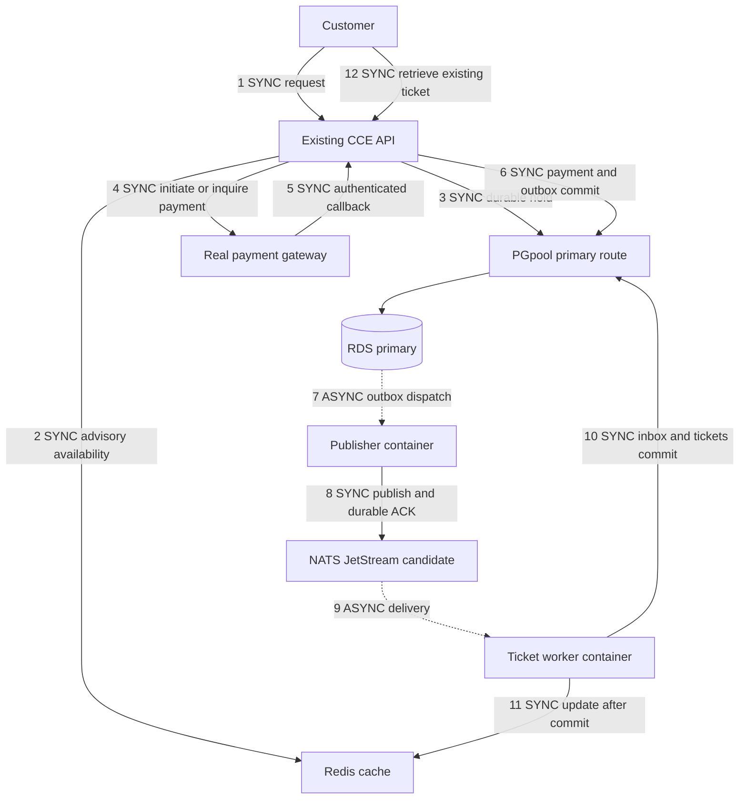

# Transfer ticketing patterns into the customer application

This pack is for the customer's developer team lead and backend engineers. Implement the booking and recovery contracts in the existing application language, while retaining CCE, PGpool and RDS. The deliverable is an implementation specification, not a completed customer port.

For a shared developer, QA, cloud engineer and architect delivery plan, start with the [team implementation guide](../implementation-guide.md).

Start with [the five contracts and pseudocode](contracts.md), then use [the acceptance checklist](acceptance-checklist.md) to verify the port. [ADR0325](../../adr/0325-transfer-ticketing-patterns-to-customer-stack.md) records the proposed integration boundary.

## Customer stack and proposed responsibilities

| Component | Responsibility | Integration condition |
| --- | --- | --- |
| Existing CCE API | Authenticate customers, validate requests, expose holds, payment inquiry and order retrieval | Preserve existing identities, API compatibility and business rules |
| Redis, proposed addition | Availability and actor-scoped status reads; optional atomic provisional booking intake | Introduce cached reads first; provisional intake is a separate activation |
| Existing NATS | Durable event transport if JetStream is available and qualified | Core NATS alone is insufficient for recoverable financial work |
| PGpool on ECS | Connection reuse and verified routing to primary or suitable replicas | Verify configuration and failover; do not copy the reference PgBouncer budget |
| RDS primary | Durable seat ownership, payments, bookings, tickets, outbox and consumer receipts | One booking authority and enforced uniqueness |
| Five reported RDS replicas | Catalogue, reporting and other reads that tolerate replication delay | Confirm which nodes are readable replicas versus HA standbys |
| Separate CCE worker containers | Outbox publisher, ticket issuance, status projection and reconciliation | Independently bounded concurrency; image and configuration pinned |

The NATS adapter is proposed work. The current reference uses Kafka. Redis scripts and SQL can inform implementation, but replacing their semantics with NATS KV requires a separate design.

## Proposed customer journey

Solid edges mean that operation waits for a result. Dashed edges mean work runs independently of the customer request. Step 4 starts only after any database transaction has committed and its connection has been released. Ticket issuance is asynchronous even though the worker waits for its own database commit.

Initially retain PostgreSQL-first holds. The optional Redis-first phase replaces step 3 with atomic provisional intake, a 202 PENDING response, and a writer that commits the durable hold before checkout. Do not run both booking paths independently against the same seats.

## Implementation sequence

1. Map existing customer, show, seat, order, payment and ticket identifiers. Inspect uniqueness, payment signature/inquiry/refund contracts, JetStream settings and PGpool routes. Record the customer's language and framework.
2. Establish a baseline through the customer's API and real gateway sandbox. Count unique paid-and-issued tickets, full customer latency and every scheduled journey.
3. Add primary-backed idempotency and payment inquiry, followed by bounded customer recovery. Preserve original reservation expiry.
4. Commit financial effects and outbox rows together. Add a durable publisher and duplicate-safe ticket worker using either the existing qualified JetStream or the Kafka reference.
5. Add status and availability caching with bounded freshness, cache-miss coalescing and a controlled aggregate connection budget.
6. Pilot one isolated event with feature flags. Introduce Redis-first intake only if measured booking contention warrants it; then repeat contention, failover and durability tests.

Port one slice at a time. Do not rewrite the entire Python application or change infrastructure sizes as part of translating these contracts.

## What can be reused

| Asset | Transfer approach |
| --- | --- |
| Redis Lua and ownership/expiry rules | Reuse compatible scripts and key placement, then test with the target Redis deployment |
| PostgreSQL transactions and constraints | Map to the customer's schema; preserve locking order and uniqueness |
| Request and event contracts | Preserve identifiers and semantics; adapt HTTP/framework conventions |
| Python application and worker logic | Translate into the customer's language or expose a service boundary |
| Tests | Reimplement the scenarios against the customer's stack; Python tests are reference evidence |
| Kafka adapter | Replace only through the durable transport contract if JetStream is chosen |
| Simulator | Replace with a real gateway adapter; never expose simulator controls as customer payment APIs |

## Evidence and scope

The reference is repository commit `bc71b713e5dbaf3d4f9129766064910692fb783e`, with the exact measured image and installed-source hashes in the [ADR0324 image receipt](../../capacity/cce/fulfillment-transaction-batching-local-2026-10-14.json). Workspace source alone does not establish image identity.

[The latest comparison](../../capacity/cce/fulfillment-transaction-batching-comparison-2026-10-14.json) ran on 14 October 2026, 19:27:50–19:32:50 Bangkok time. It offered 102 journeys/s for 300 seconds: 30,600 dispatched and fulfilled, zero drops, five initial payment errors recovered and zero final failures. The conservative in-window rate was 100.90 paid-and-issued tickets/s. Worst-shard total journey p95 was 2.615 seconds; all queues drained and audited financial checks passed. The customer gateway was simulated. This measured point does not qualify the customer implementation or the new batching configuration for an hour.

Batch four is an experimental optimization under ADR0324. Start the customer port with batch one and qualify grouping separately. The prototype has no customer frontend or waiting room.

## Customer details needed for implementation

- Application language, framework, runtime version and API compatibility requirements.
- Schema and business rules: multi-seat atomicity, purchase limits, transfer/cancellation and payment retries.
- Current seat writer, expiry process and inventory ownership during migration.
- Gateway signature validation, idempotency retention, operation inquiry, callback retry and refund behavior.
- NATS version, whether JetStream is enabled, persistence/replication, retention, consumer configuration and ordering requirements.
- PGpool version, instance count, child/pool limits, database/user combinations, routing and failover.
- RDS primary/replica topology, measured connection headroom and customer latency/freshness targets.

These inputs determine code and sizing. Their absence does not prevent the team from reviewing the contracts.

## Rollout and rollback

Assign each pilot event one booking path and record its ownership before enabling traffic. Pin image digests, migrations, flags and budget values. Preserve existing gateway and ticket identities.

On rollback, stop new intake for the pilot, recover committed payments, drain or explicitly transfer pending reservation commands and events, and reconcile inventory before restoring the old writer. Do not delete outbox/inbox records or switch writers while unresolved paid orders remain. Retain audit evidence and reconcile gateway settlement to issued tickets or durable refund/review obligations.
